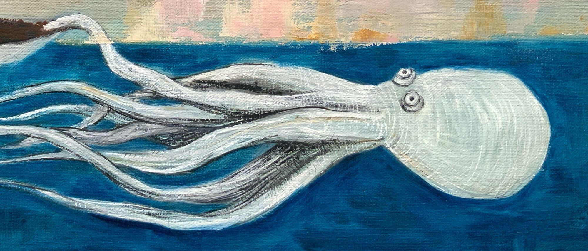
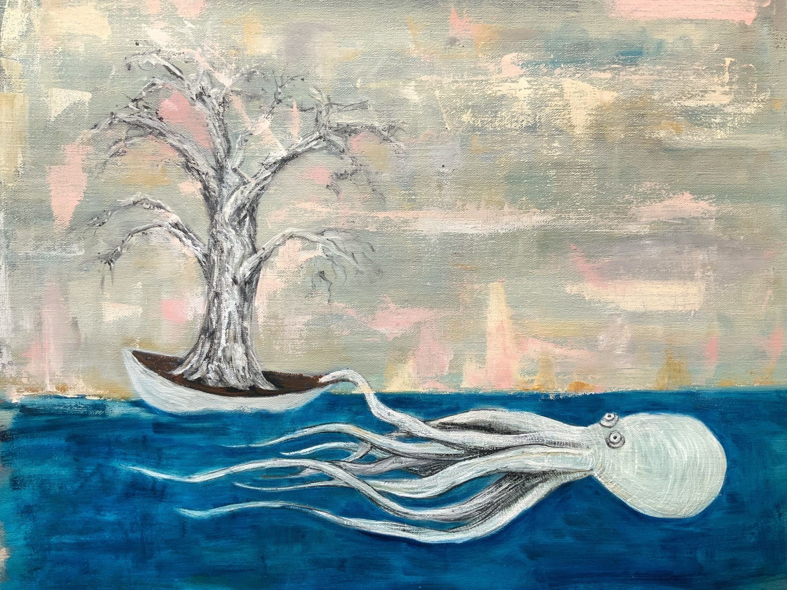

+++
title = "Absconding Octopus"
date = 2021-03-22
template = "log/single.html"
+++

<!-- From intentionallyconfusing.com/absconding-octopus/ (2021-03-22), Kyle's words as he
     posted them, spelling included; only Ghost's title line and empty
     trailing heading were dropped. In the archive this looks like "transplanter" (an octopus towing an alligator juniper, 16x20, 2021): matched by subject and size, the title differs, not linked until Kyle confirms. -->

*Absconding Octopus, Oil on Linen, 16x20, 2021*

Somewhere out there in the ocean an octopus saves a little tree pulling it miles over the ocean to secret sea creature the island hiding spots.  The tree was carefully transplanted onto a raft like floaty bit, the upmost care was given to preserve even the most fragile of roots.  

Said octopus elegently grabs a hold with one arm and does the alien worm drive swim over the horizon to those few spots humans cannot find and replants, oh so lovingly.

This whole idea is absurd, I know, but so to is so much of what we humans do.

This one though really is making a fast getaway with that sweet little tree.
