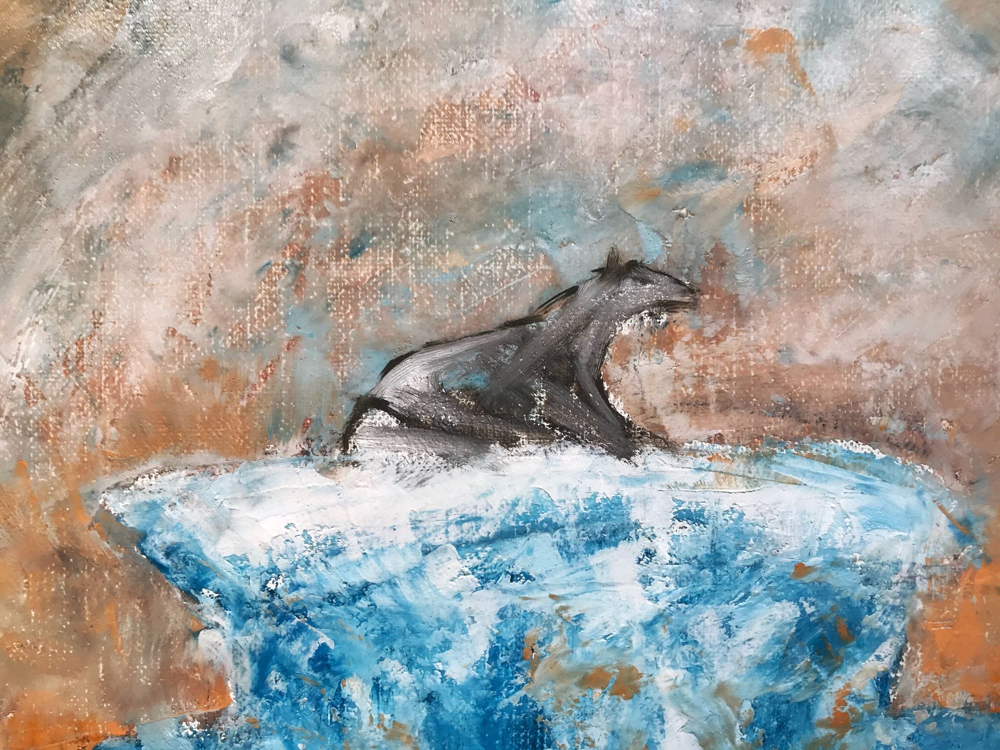
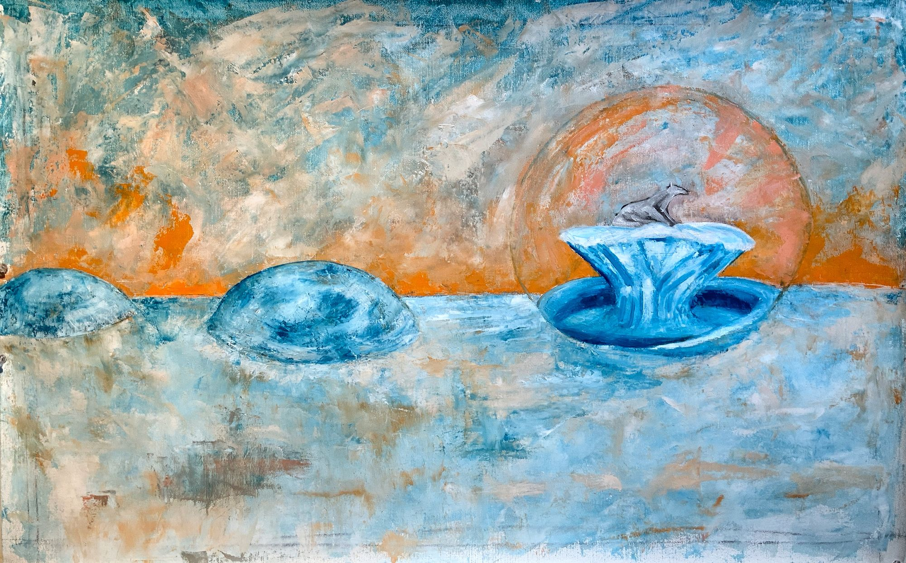

+++
title = "Polar Life Raft"
date = 2021-04-21
template = "log/single.html"
+++

<!-- From intentionallyconfusing.com/polar-life-raft/ (2021-04-21), Kyle's words as he
     posted them, spelling included; only Ghost's title line and empty
     trailing heading were dropped. Archive record: https://archive.kyleparkercunningham.com/works/there-once-was-ice-here (it quotes this post). The post says approx 21x24", the archive 21x34 inches; one is wrong. -->

These polar bears, they learned how to blow glass and crafted mostly round bubbles to live in.  They filled them with water and froze them solid and live inside one until it melts, escape and appear in the next bubble as if by magic.  Or Imagination. Or space age teleportation technology.

Binary detritus of a bygone era.

I very much enjoy paintings at this stage, that is, half way realized.  There is much work still but the body and soul of the painting have begun to reveal themselves.  I’m not quite happy with the iceberg polar bear pedestal but I see where it’s going and can’t wait for the paint to dry. Layers on layers.

How long could a polar bear live in a bubble anyways

Oil on linen, approx 21x24" (fibanocci)
