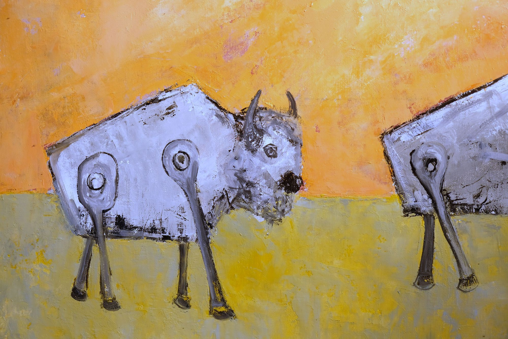
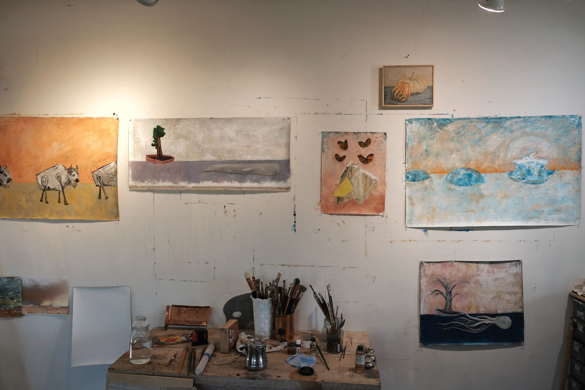
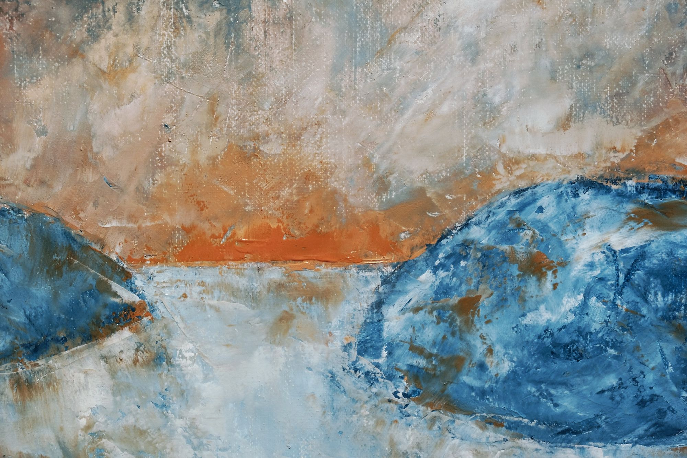
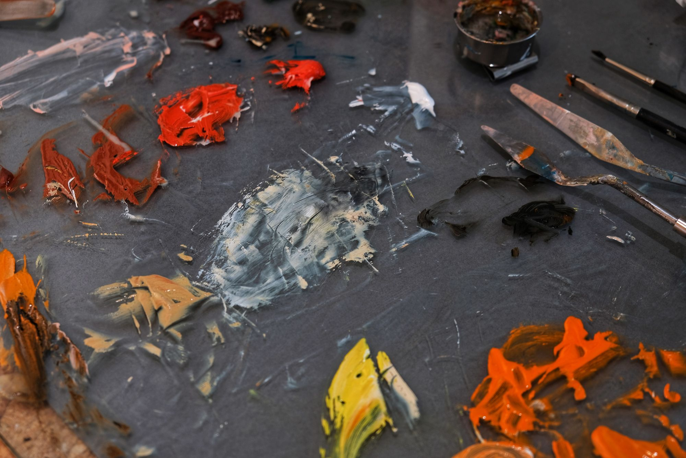

+++
title = "This Spring Palette"
date = 2021-04-21
template = "log/single.html"
+++

<!-- From intentionallyconfusing.com/this-spring-pallete/ (2021-04-21), Kyle's words as he
     posted them, spelling included; only Ghost's title line and empty
     trailing heading were dropped. Four studio photographs, the works in them not identified. The old slug misspells "pallete"; this one keeps it so the redirect stays simple. -->

New work up on the wall in my studio - continuing on with this series about climate and change and the worlds response to it.  I'm still lost in the fantasy world, imagining nature as a cargo cult for human technology.  The transfusion of gizmos is fully realized here in this world where nature does what it always does and adapts.

Sea creatures tugging trees is a miny theme this last month, I can't get that image out of my head.  

I'm very much enjoying the palette of colors I'm working in this spring - washed out intensity.  Lots of palette knife painting on all these resulting in thost magical background textures.  

